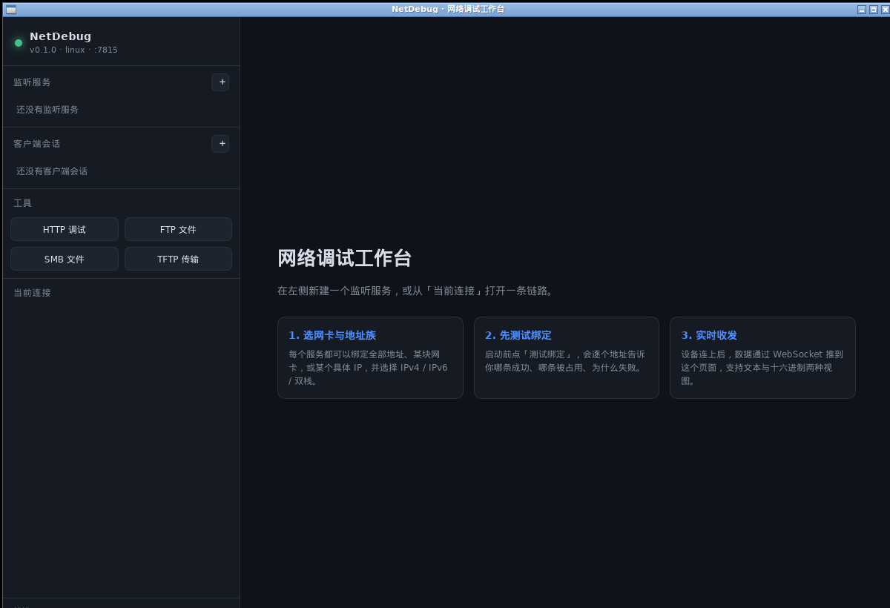
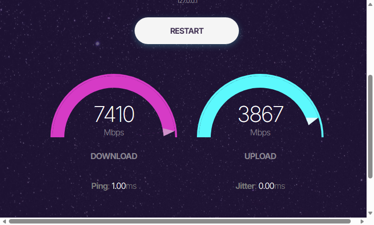
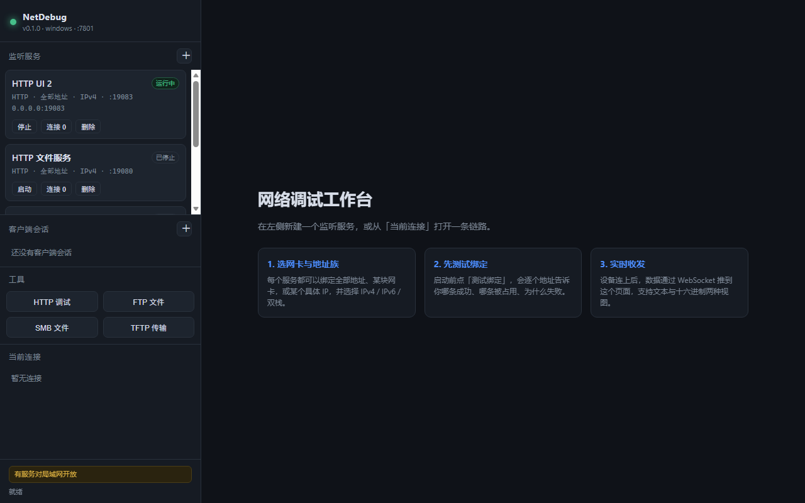
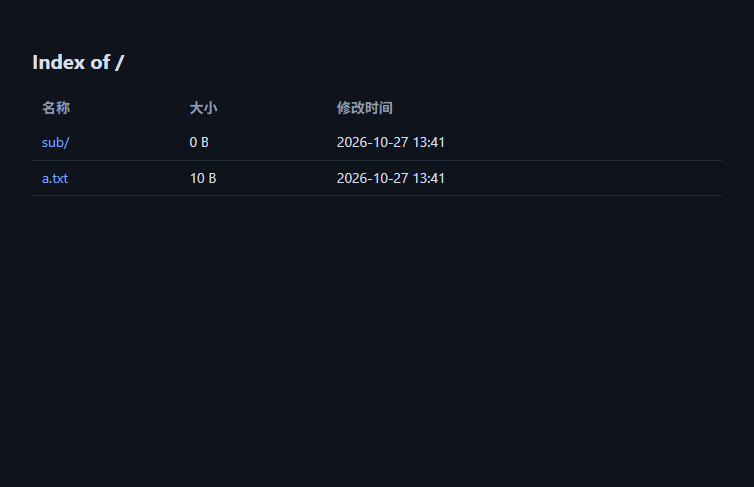
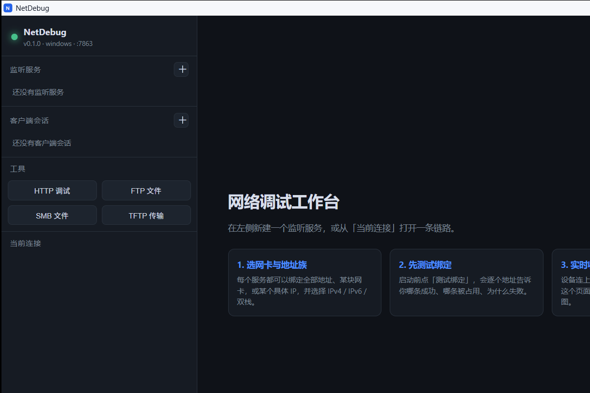

# NetDebug

[](https://github.com/tangshenfei/NetDebug/releases)
[](LICENSE)

本机运行、原生窗口内嵌 WebView2 的多协议网络调试工作台。后端全部用 C 实现，前端是内嵌在可执行文件里的单页应用。

## 下载

[Releases](https://github.com/tangshenfei/NetDebug/releases) 提供两个平台的开箱包：

- **Windows x64**：`netdebug-<版本>-win64.zip`，解压双击 `netdebug.exe`，免安装、不写注册表（需要系统 WebView2 Runtime，Win11 自带）
- **Linux x86_64**：`netdebug-<版本>-linux-x86_64.tar.gz`，解压后 `chmod +x netdebug && ./netdebug`（需 glibc ≥ 2.34 + GTK3 + WebKitGTK 4.1，即 Ubuntu 22.04+ / Debian 12+ / Fedora 35+）

其他发行版或架构按下面的「构建」一节自行编译即可。


## 当前状态（M6）

| 能力 | 状态 |
|---|---|
| Windows / Linux 构建 | ✅ |
| 管理页仅绑定 `127.0.0.1` + `::1` | ✅ |
| 网卡枚举（名称、MAC、MTU、v4/v6 地址、scope） | ✅ |
| 监听规划：全部地址 / 网卡 / 指定 IP × IPv4 / IPv6 / 双栈 | ✅ |
| 绑定前测试（逐地址返回成功/失败原因） | ✅ |
| 原始 TCP 服务端（多连接、实时收发、HEX/文本） | ✅ |
| 原始 TCP 客户端会话（地址族、源网卡/源 IP、失败逐地址汇报） | ✅ |
| 前端终端（WebSocket 二进制流、方向/时间戳/HEX） | ✅ |
| 服务配置持久化（services.json，重启恢复） | ✅ |
| 监听服务编辑（名称/协议/端口/绑定/根目录，运行中自动重启） | ✅ |
| 单实例：重复启动激活已有实例的内嵌服务面板 | ✅ |
| 原始 UDP（服务端按对端通道收发 + 客户端会话） | ✅ |
| Telnet 客户端/服务端（IAC 协商、NAWS/TTYPE、控制字节剥离） | ✅ |
| 串口（枚举 / DCB 参数 / 读写线程 / POSIX termios） | ✅ Windows 已验证枚举与错误路径；收发需真实设备 |
| HTTP/1.1 客户端（原始报文、分块、重定向、耗时、二进制） | ✅ HTTPS 待接 TLS 库 |
| FTP 客户端 + 服务端（PASV/EPSV、MLSD/LIST、上传下载、只读、根目录隔离） | ✅ |
| TFTP 客户端 + 服务端（RRQ/WRQ、blksize/timeout/tsize、重传、只读） | ✅ |
| HTTP 服务端（静态文件、目录列表、index.html、MIME、GET/HEAD、echo 模式） | ✅ |
| LibreSpeed 测速服务（LAN 客户端下载/上传/延迟，LGPLv3 前端 + C 后端） | ✅ |
| SSH 客户端（libssh2/WinCNG、密码/公钥、PTY shell、兼容模式） | ✅ shell 可用；SFTP/known_hosts 待补 |
| SMB2/3 客户端（NTLMv2、共享浏览、上传下载、目录操作） | ✅ Windows 与 Linux 均已实测 |
| 桌面 / 窄屏自适应（<900px 抽屉侧栏、表单换行、对话框滚动） | ✅ |

## 构建（Windows）

需要 64 位 MinGW-w64 与 CMake 3.20+。仓库内 `tools/` 目录是本地工具链，不参与提交。

```powershell
.\build.ps1
```

产物：`build\netdebug.exe`，单个文件。`WebView2Loader.dll` 已作为资源嵌入 exe，首次启动时释放到数据目录下的 `webview2\`，不再需要随 exe 单独复制。

Windows 版使用系统自带的 **WebView2 Runtime**（Windows 11 默认安装，Windows 10 如缺失可从微软官网安装）。不需要 Edge/Chrome 的独立窗口，也不会复用你已打开的管理员 Edge 实例。

## 构建（Linux）

```bash
sudo apt install libgtk-3-dev libwebkit2gtk-4.1-dev   # 图形界面（可选）
cmake -S . -B build -DCMAKE_BUILD_TYPE=RelWithDebInfo
cmake --build build -j
./build/netdebug
```

依赖：gcc/clang、CMake、pthread；图形界面需要 GTK3 + WebKitGTK（未安装时自动退化为命令行模式）。
Linux 版已用 Ubuntu 24.04 / WSL2 编译并运行验证（窗口、HTTP 管理页与 SMB 客户端均实测）；Linux 下 SSH 暂未启用（libssh2 需要 OpenSSL 后端）。

## 运行

```powershell
.\build\netdebug.exe
```

默认打开的就是一个全窗口的内嵌管理页：Windows 用系统 WebView2，Linux 用 GTK + WebKitGTK。没有第二个控制卡窗口，也没有外部浏览器。左侧栏管理监听服务和客户端会话，HTTP/FTP/TFTP/SMB 工具都在里面；关闭窗口标题栏的 X 会停止所有服务并退出。

终端和工具各占一个顶部标签页，可以并存、切换、点 × 关闭；终端标签按连接区分，切走再切回来历史输出还在。

管理界面只在程序窗口里提供，不通过浏览器访问；`--console` 是不开窗口的服务模式，启动后打印带 token 的调试接口地址，供脚本或排障使用。再次启动同一个程序时，会激活已有实例的同一个窗口。

Linux 下的同一个窗口：



HTTP 服务端在「监听服务」里新建：

- 协议选 **HTTP 服务端**；
- 端口例如 `8080`；
- 根目录填一个放 `index.html` 的目录，留空则用数据目录下的 `http-root`；也可以点 **「选择目录…」** 调起 Windows 自带文件夹选择器；
- 目录里没有 `index.html` 时，会列出目录内容（文件夹、文件名、大小、修改时间）；
- 启动后浏览器访问 `http://127.0.0.1:8080/` 即可；
- 勾选 echo 时，服务端会把收到的请求头和请求体原样返回，适合抓客户端请求。

HTTP 服务的卡片会显示 **请求 N**（累计请求数）和 **活跃 N**（当前正在处理的请求）。HTTP 是短连接，`Connection: close` 后活跃数会回到 0，但请求总数会一直累加。

## LibreSpeed 测速服务

在「监听服务」里协议选 **LibreSpeed 测速**，选端口和绑定地址后启动，其它设备访问：

```
http://<NetDebug 所在 IP>:<端口>/
```

测量的是**客户端到 NetDebug 这台机器**的下载、上传、延迟和抖动，适合测 LAN / 路由 / 网线。

- 前端使用 [LibreSpeed](https://github.com/librespeed/speedtest) 的现代 UI，未修改其测试逻辑；
- 不依赖 PHP/Go/外部进程，C 后端直接实现 `/garbage.php`、`/empty.php`、`/getIP.php`；
- 前端资源在 `web/speedtest/`，许可证为 **LGPLv3**（`web/speedtest/LICENSE` / `third_party/librespeed/LICENSE`），发布时请保留；
- 测速服务默认无认证，绑定到 LAN 地址时请只在可信网络使用。







直接关闭窗口等同于“停止服务并退出”。控制台模式用于调试/自动化（不开窗口）：

```powershell
.\build\netdebug.exe --console
```



控制台模式启动后会打印一行带 token 的调试接口地址：

```
调试接口: http://127.0.0.1:7801/#t=<本次运行的 token>
```

- 界面只在程序窗口里提供（Windows 用 WebView2，Linux 用 GTK + WebKitGTK），浏览器访问只会看到「请使用 NetDebug 主窗口」。
- token 放在 URL fragment 里，不会进入 Referer 或服务端日志；前端读取后放在 `X-Auth-Token` 请求头里。
- 管理接口只监听回环地址；被调试的服务可以按网卡/IP 开放到局域网。
- `--port 7801` 指定管理端口；`--console` 不开窗口，仅命令行运行。
- 运行数据（日志、token）默认在 `%APPDATA%\NetDebug\`（Linux：`~/.config/netdebug/`）。
- 如果默认目录不可写（受限终端、只读环境、便携运行），程序会自动依次尝试 `%LOCALAPPDATA%\NetDebug\`、可执行文件同级的 `NetDebug-data\`、当前目录的 `.netdebug\`，并在启动时打印 `note: ... is not writable; using ...`。
- 日志固定写到数据目录下的 `logs/netdebug.log`，启动成功后会打印实际路径。

## 测试

单元测试使用项目自带的轻量框架（`tests/test_framework.h`），覆盖纯逻辑与可本地验证的组件：

| 套件 | 覆盖内容 |
|---|---|
| core.util | 字符串剪裁、十六进制编解码、UTF-8 校验、错误码文本、随机数 |
| core.container | 环形缓冲环绕/满空边界、帧队列容量上限/关闭语义/多线程收发 |
| net.addr | IPv4/IPv6 解析与格式化、scope id、IPv4 映射地址归一化、地址分类、sockaddr 互转 |
| net.url | URL 解析、重定向的绝对/相对地址解析、非法输入拒绝 |
| net.planner | 绑定规划矩阵（全部地址/网卡/指定 IP × v4/v6/双栈）、降级与失败路径、真实 bind |
| httpd | SHA1 标准向量（含百万字节分块）、Base64 编解码、URL 解码、查询串取值 |
| proto.telnet | IAC 转义、协商命令剥离、子协商、跨数据包状态机 |

```powershell
# 直接运行
.\build\tests\test_core.exe

# 生成 JUnit XML + Markdown 报告
.\build\tests\test_core.exe --junit build\test-results.xml --md build\test-report.md

# 或通过 CTest（会同时生成报告）
ctest --test-dir build --output-on-failure
```

当前结果：**44 个用例 / 449 个断言 / 0 失败**，Windows 与 Linux 均通过。

- 报告（Windows）：[test-report.md](docs/test-report.md)
- 报告（Linux）：[test-report-linux.md](docs/test-report-linux.md)

### 界面专项测试

用 CDP 驱动 headless Edge 跑真实页面与真实接口，覆盖服务增删改启停、绑定校验、会话表单联动、终端收发、HTTP/FTP/TFTP 工具、移动端布局：

```powershell
# 需要先启动应用（控制台模式）和一个带 --remote-debugging-port=9280 的 Edge
node tests\ui\ui_test.mjs --md docs\ui-test-report.md
```

当前结果：**25 个用例 / 128 个断言 / 0 失败**，报告见 [ui-test-report.md](docs/ui-test-report.md)。

`tests/ui/qa_doc_*.mjs` 是使用手册的截图生成脚本（跑完后覆盖 `docs/images/guide/`），同理需要应用与 Edge 在运行。

## 使用手册

逐步操作说明（含界面截图与各协议配置流程）：[docs/user-guide.md](docs/user-guide.md)

## 目录

```
src/core       日志、错误码、环形缓冲、帧队列、线程封装、工具函数
src/platform   平台层：socket、网卡、单实例、原生控制窗口、WebView2 面板
src/net        地址解析、监听规划器、网卡枚举
src/session    连接、服务生命周期、引用计数
src/proto      协议实现：HTTP/FTP/TFTP/SSH/Telnet/SMB2，以及 FTP/TFTP 服务端
src/httpd      内嵌 HTTP/1.1 + WebSocket 服务、REST API、静态资源
web/           前端源码（构建时嵌入可执行文件）
tests/         单元测试（ctest）
docs/          需求与设计文档
```

## 设计要点

- 每个监听服务先经过「监听规划器」：网卡可以有多地址，双栈在绑定具体 IP 时不成立，这些规则集中在 `src/net/planner.c`，可以脱离真实网卡单测。
- 每条连接一个接收线程；浏览器方向走 WebSocket 二进制帧（8 字节时间戳 + 方向 + 数据），避免 base64 膨胀。
- 服务与连接都带引用计数，API 查询、广播、关闭流程不会出现 use-after-free。
- 管理面校验 `Host`/`Origin`/token，防 DNS rebinding 与跨站请求；不返回 CORS 头。

## 已知限制

- HTTPS 未启用（HTTP 客户端可用）；需要引入 OpenSSL/mbedTLS。
- Windows 内嵌面板依赖系统 WebView2 Runtime；极简 Windows 10 镜像可能未预装。
- SSH 仅在 Windows 构建启用（libssh2 + WinCNG）；Linux 版需要 OpenSSL 后端。SFTP 与 known_hosts 校验未完成。
- SMB 仅客户端，支持 SMB2/3 + NTLMv2；未做共享枚举、Kerberos、SMB1。
- 串口已实现枚举与参数配置，真实收发尚未用硬件验证。
- FTP/TFTP/SMB 页面上传走 base64，单文件限制 3MB。
- HTTP 服务端目前只支持静态文件、目录列表和 GET/HEAD；PUT 上传、自定义状态码/响应体、HTTPS 暂未实现。
- LibreSpeed 只启用下载/上传/延迟/抖动；ISP 信息、距离、结果分享、telemetry 数据库不启用。

## 开发文档

- [需求整理 v0.3](docs/requirements-v0.3.md)
- [详细设计 v0.1（M0 基线）](docs/design-v0.1.md)

## 许可证

本项目采用 [MIT License](LICENSE)，版权所有 (c) 2026 tangshenfei。

第三方组件各自遵循其原始许可证，见 [THIRD_PARTY.md](THIRD_PARTY.md)：cJSON（MIT）、libssh2（BSD-3-Clause）、libsmb2（LGPL-2.1）、Microsoft WebView2 SDK（Microsoft 软件许可）、LibreSpeed（LGPL-3.0）。
