# NetDebug 使用手册

面向实际操作：从启动、建服务、连设备到收发数据，每一步都对应界面上的位置。
截图来自真实运行实例（Windows 11，1400×880 桌面尺寸与 390×780 移动端尺寸）。

---

## 1. 启动

双击 `netdebug.exe`（Linux 下执行 `./netdebug`）打开主窗口，管理界面就嵌在窗口里，没有浏览器这一层。

命令行方式（便于排障或做成快捷方式）：

```powershell
.\netdebug.exe                     # 主窗口（默认）
.\netdebug.exe --port 7801         # 指定管理端口
.\netdebug.exe --console           # 不开窗口，仅命令行运行
```

- 默认管理端口 **7801**，只监听 `127.0.0.1` 和 `::1`，局域网访问不到管理接口。
- 同一时间只允许一个实例；再次启动会把已有窗口激活。
- **界面只在程序窗口里**。`--console` 是不开窗口的服务模式，启动后会打印一行带 token 的调试接口地址，
  浏览器直连 `http://127.0.0.1:7801/` 会看到「请使用 NetDebug 主窗口」。

同一个界面在 Windows 与 Linux 上一致（Windows 用 WebView2，Linux 用 GTK + WebKitGTK）：

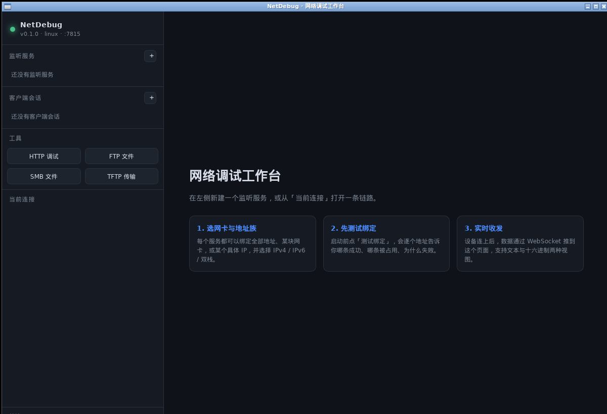

数据目录：Windows 默认 `%APPDATA%\NetDebug\`，Linux 默认 `$XDG_CONFIG_HOME/netdebug`（或 `~/.config/netdebug`）；不可写时依次退到用户目录、exe 同级目录。用环境变量 `NETDEBUG_HOME` 可以直接指定。程序日志第一行会打印实际使用的目录。

| 文件 | 内容 |
|---|---|
| `services.json` | 监听服务配置（含是否自动恢复） |
| `runtime.json` | 本次运行的端口与 token |
| `logs/netdebug.log` | 运行日志 |
| `http-root/`、`ftp-root/`、`tftp-root/` | 文件服务的默认根目录 |
| `downloads/` | FTP/TFTP 下载落盘位置 |

---

## 2. 界面结构


整个界面是单页三块：

- **左侧栏**：监听服务、客户端会话、工具入口、当前连接，底部是连接状态与「有服务对局域网开放」提示。
- **顶部标签页**：终端和工具各占一个标签，可以并存、点一下切换、点 `×` 关闭；关掉最后一个标签回到欢迎页。终端标签按连接区分，切走再切回来历史输出还在。
- **右侧工作区**：默认是欢迎页；打开终端或工具后在这里显示内容。

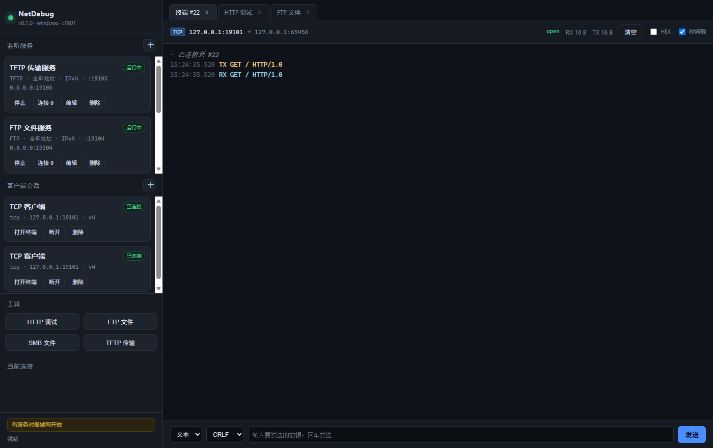

概念上只有两类东西：

| | 监听服务 | 客户端会话 |
|---|---|---|
| 方向 | 等别人连进来（服务端） | 主动连出去（客户端） |
| 例子 | 让设备连你的 TCP 9000 | 连设备上的 Telnet 23 |
| 生命周期 | 持久化，重启后按需自动恢复 | 只在本次运行内存在 |

工具（HTTP/FTP/TFTP/SMB）是独立的调试器，不占连接列表。

---

## 3. 新建监听服务

点「监听服务」右上角的 `＋`。对话框顶部是一排**协议磁贴**（TCP / UDP / Telnet / FTP / TFTP / HTTP / 测速），点一下切换协议，下面只显示该协议用得到的字段。

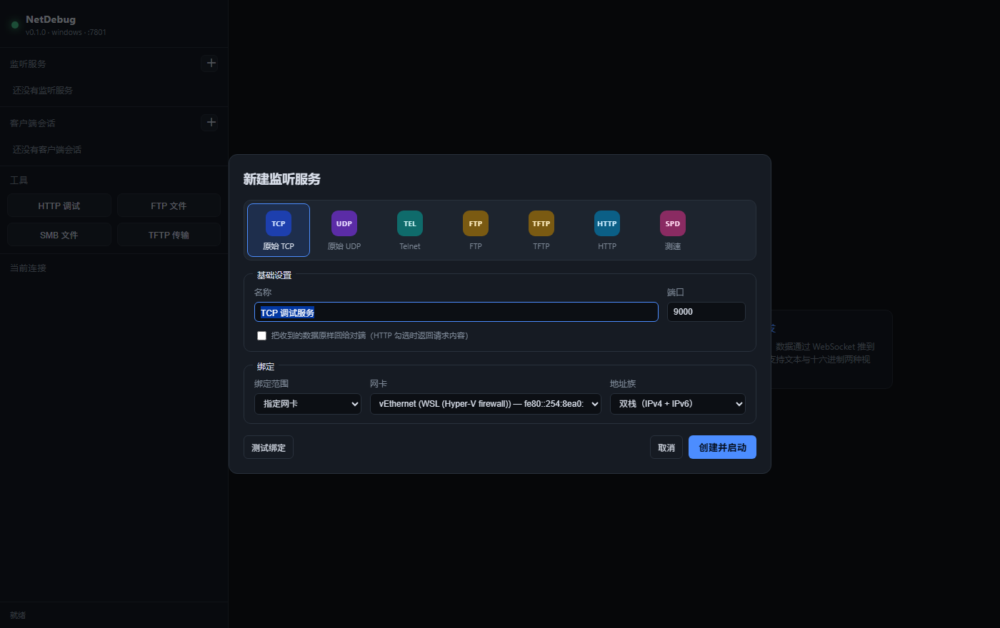

字段说明：

| 字段 | 说明 |
|---|---|
| 名称 | 只用于界面显示；切换协议时会自动给出建议名，手动改过就不再覆盖 |
| 协议 | 原始 TCP / 原始 UDP / Telnet / FTP / TFTP / HTTP 服务端 / LibreSpeed 测速 |
| 端口 | `1–65535`；新建时按协议给出默认值并随机偏移（见下表），填 `0` 表示让系统分配空闲端口 |
| 绑定范围 | 全部地址 / 指定网卡 / 指定 IP |
| 地址族 | 仅 IPv4 / 仅 IPv6 / 双栈 |
| 回声 | 收到的数据原样发回对端，做回环测试最省事 |

**默认端口**按协议取值，并在基准上随机偏移 0–99，连续新建多个不会都撞在同一个端口；切换到其它协议时会重新取一个，但**手动填过的端口不会被覆盖**：

| 协议 | 基准端口 | 实际范围 |
|---|---|---|
| 原始 TCP | 9000 | 9000–9099 |
| 原始 UDP | 9100 | 9100–9199 |
| Telnet | 2323 | 2323–2422 |
| FTP | 2121 | 2121–2220 |
| TFTP | 6969 | 6969–7068 |
| HTTP | 8080 | 8080–8179 |
| LibreSpeed 测速 | 8081 | 8081–8180 |

之所以用 `2323` / `2121` / `6969` 这类「常用端口 +1000」而不是 23 / 21 / 69：1024 以下的端口在 Linux 上需要 root 才能绑定，默认值会直接失败。想用标准端口时手填即可（Windows 下 1024 以下不需要管理员）。

### 3.1 绑定范围怎么选

- **全部地址**：`0.0.0.0` 或 `::`，所有网卡都能连进来，最常用。
- **指定网卡**：只在该网卡的地址上监听。网卡有多个地址时，会为每个地址各开一个监听；选双栈时 IPv4 和 IPv6 各一条。
- **指定 IP**：只绑这一个地址。**这种情况下不能选双栈**——一个具体 IP 只有一个地址族，界面会提示失败。

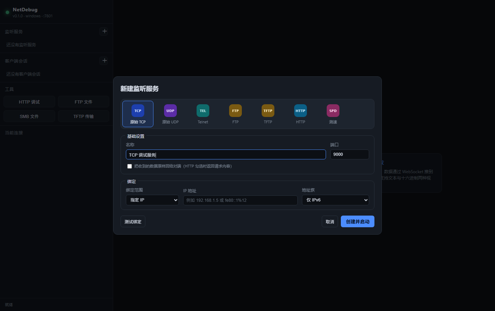

### 3.2 先测试绑定，再启动

点「测试绑定」，会逐个地址试一遍并给出结论，不会真的占住端口：

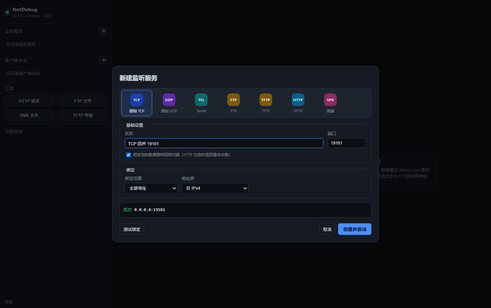

成功时显示 `成功 0.0.0.0:19101`。端口被占用时会明确指出冲突的地址和系统原因：

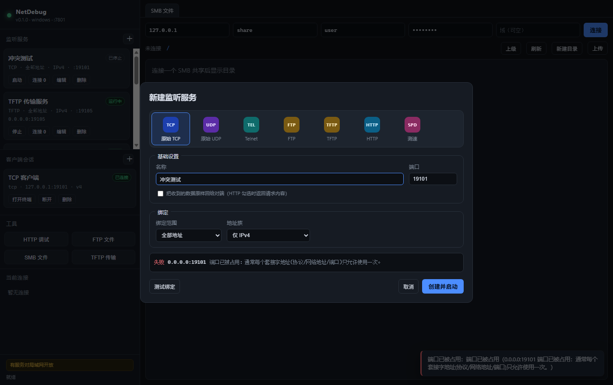

失败时对话框不会关闭，改完端口再点一次「创建并启动」即可。

### 3.3 建立后的服务卡片


卡片上显示：协议、绑定范围、地址族、端口、实际监听地址、连接数（HTTP 类服务显示请求数与活跃连接数），以及停止/启动、编辑、删除。

### 3.3.1 服务详情页

**点卡片本身**（不要点按钮）会在右侧打开「服务 · <名称>」详情页，一张页面把运行状态、指标和操作都收在一起：

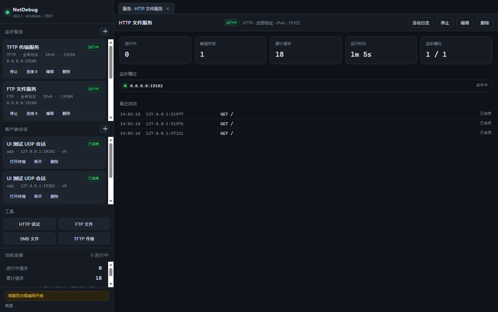

- **指标卡**：进行中、峰值并发、累计请求、运行时长、监听槽位（成功数 / 总数）。运行时长每秒刷新，峰值并发是本次启动以来的最高值，重启服务会归零。
- **监听槽位**：每个实际绑定地址一行，绿点表示监听中，红点附带失败原因（端口占用、权限不足等）。服务停止时这里显示「未运行」，不会残留上一次的绑定结果。
- **最近活动**：最近 8 条请求/连接（与日志页同源，未打开日志也会记录最近 20 条）。
- **右上角操作**：活动日志（打开该服务的日志标签）、停止/启动、编辑、删除——和侧栏卡片上的按钮等价，只是不用来回切换。


### 3.4 服务实时日志

点卡片上的「活跃 N」或「连接 N」，右侧会打开该服务的日志标签页：

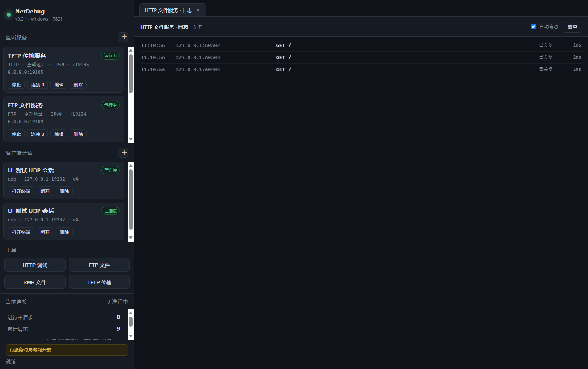

每一行是一条请求或一条连接，显示开始时间、对端地址、请求行（HTTP）或协议名、状态与耗时：

- 请求或连接建立时显示「进行中」，结束后变成「已关闭」并补上耗时
- 「自动滚动」默认开启，新记录出现时自动滚到底部
- 「清空」只清空当前标签页里的显示，不影响服务本身
- 同一个服务的日志只有一个标签页，重复点击会切回已打开的那个；不同服务各开各的

HTTP / LibreSpeed 类的服务记录的是**请求**（毫秒级，不登记为长连接）；TCP / Telnet / FTP / TFTP 记录的是**连接**（建立到关闭）。两者在同一个视图里展示，靠第三列区分。

---

## 4. 各协议的服务配置

### 4.1 原始 TCP / UDP

最通用的收发通道，适合调试自定义协议、串口服务器、IoT 设备。

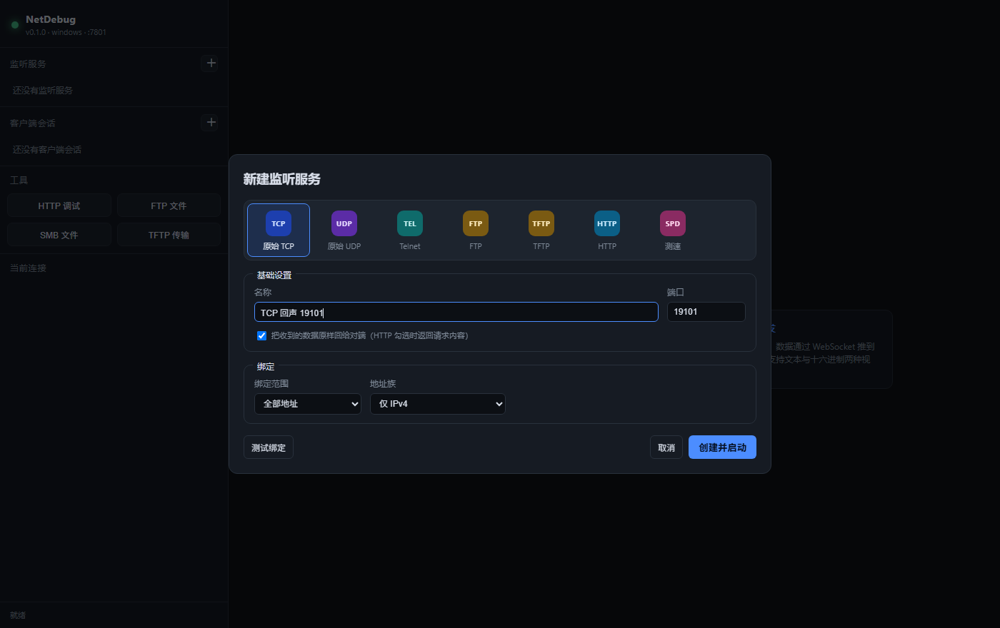

1. 协议选「原始 TCP」（或 UDP），填端口。
2. 绑定范围按需选择。
3. 想立刻验证，勾上「回声」。
4. 「创建并启动」。

启动后服务卡片显示 `运行中`，右侧监听地址即为别人该连的地址。

### 4.2 HTTP 文件服务

把本地目录通过 HTTP 提供出去，用于设备拉配置、固件、日志。

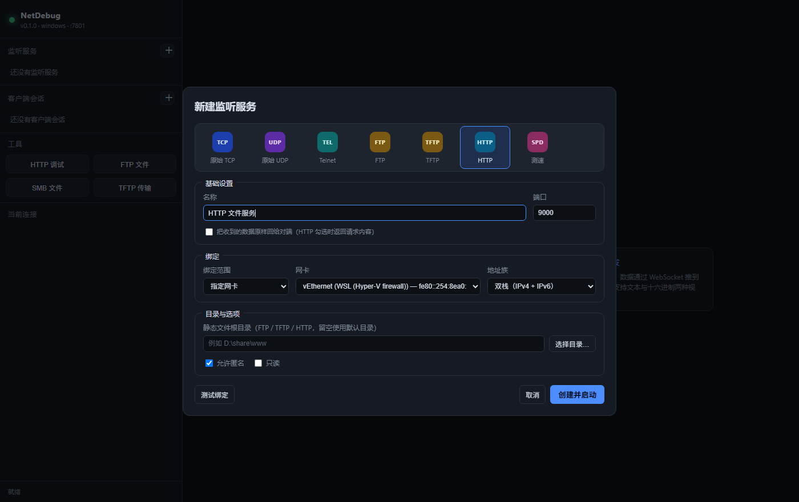

- **静态文件根目录**：留空则用数据目录下的 `http-root\`。点「选择目录…」会弹出 Windows 原生文件夹选择器。
- 根目录有 `index.html` 就返回它；没有就自动生成目录列表，不会 404。

访问效果：

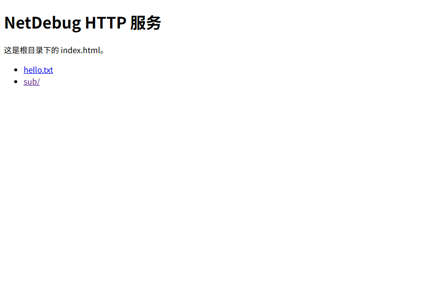

子目录同样是可点击的列表，带返回上级：

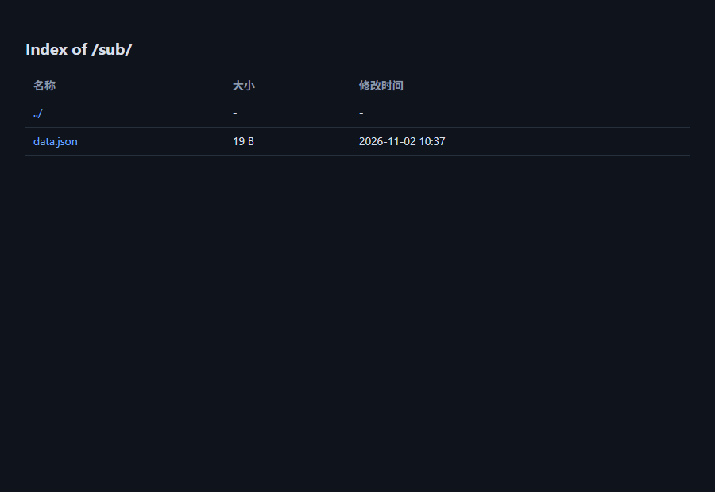

支持 GET/HEAD 与常见静态类型（html/css/js/json/txt/svg/png/jpg/gif/ico/woff2/woff/ttf/pdf）。当前不支持上传（PUT）与 HTTPS。

### 4.3 LibreSpeed 测速服务

内置 LibreSpeed 前端，后端用 C 重写，不依赖 PHP。

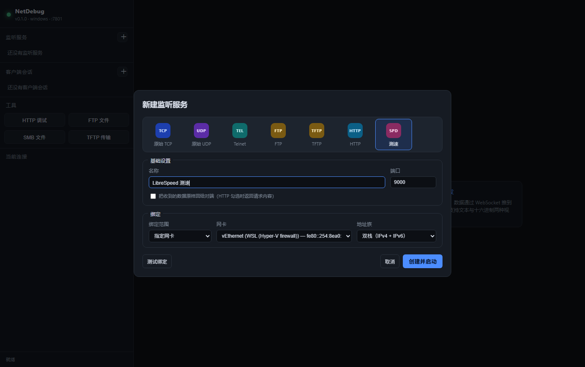

建好后用浏览器打开该端口：

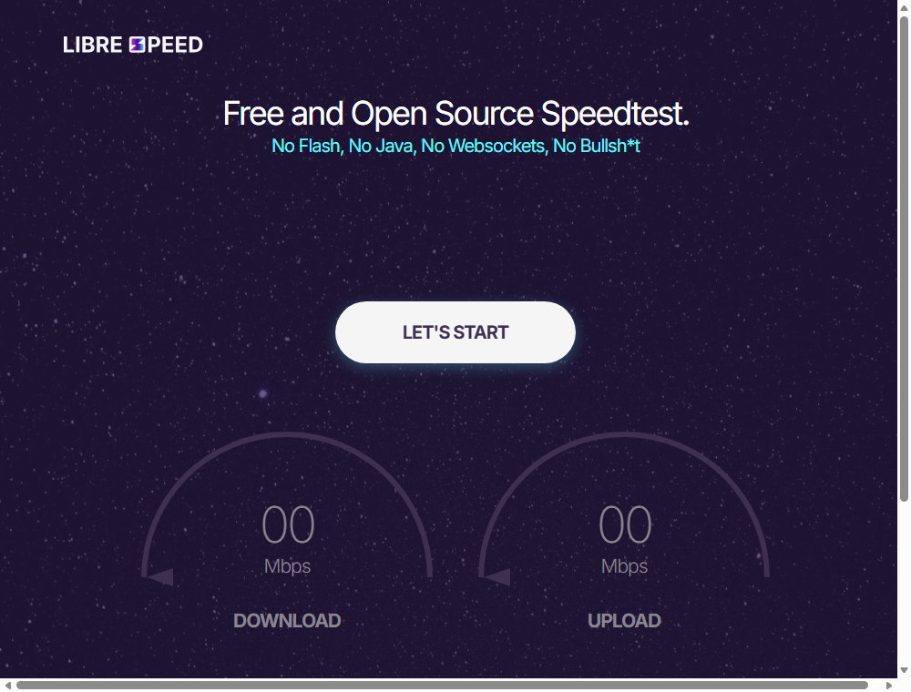

说明：

- 测速机与用户之间的真实带宽受链路限制，**回环测试**（本机连本机）会得到虚高的数字，只用来验证功能是否通。
- 只启用下载、上传、延迟、抖动；ISP 信息、结果分享、telemetry 均不启用。
- 前端为 LibreSpeed（LGPLv3），未修改，许可证随程序分发。

### 4.4 FTP 文件服务

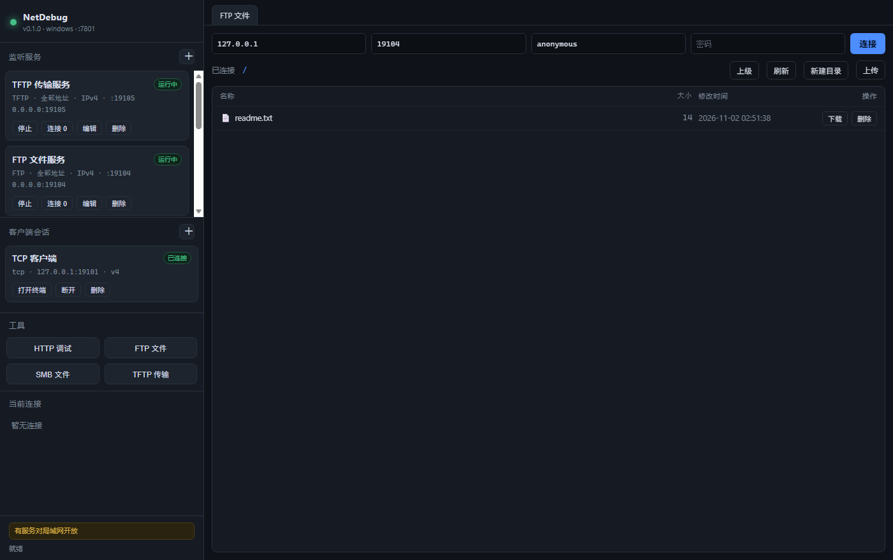

对话框中可设根目录、是否允许匿名、是否只读。被动模式端口范围写进 `services.json`，需要时可在里面调整。

### 4.5 TFTP 文件服务

UDP/69 类服务，只做单文件读写，适合给设备刷固件：

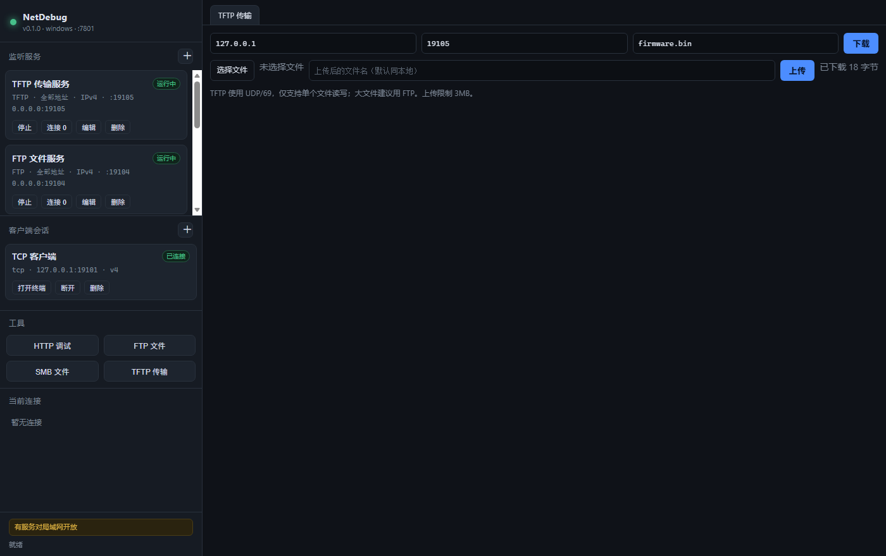

---

## 5. 编辑、停止、删除与自动恢复

- **停止**：立即关闭监听，已建立的连接一并断开。
- **编辑**：改名称、协议、绑定、端口、根目录；保存后自动按原运行状态重启。
- **删除**：会弹确认框，确认后从 `services.json` 移除。
- **自动恢复**：退出时处于「运行中」的服务会被记住，下次启动自动重新监听；退出时是「已停止」的不会自动起来。

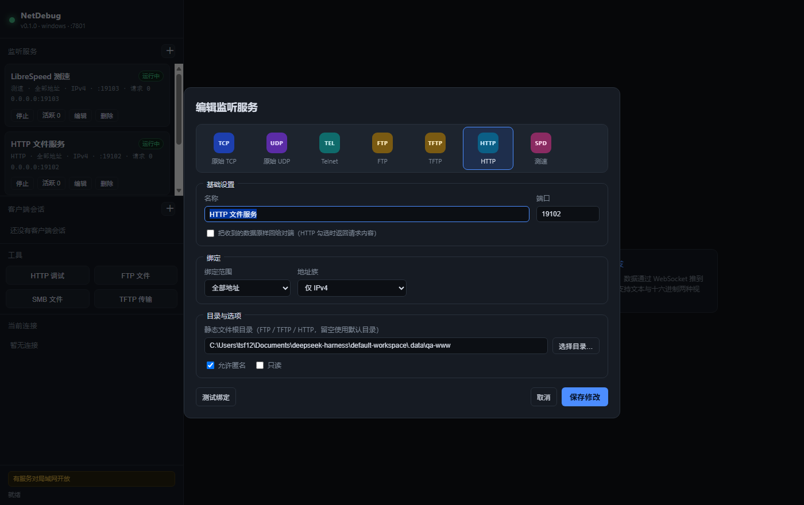

---

## 6. 客户端会话

点「客户端会话」右上角 `＋`。顶部的磁贴一步选定连接类型：原始 TCP / Telnet / 原始 UDP / SSH / 串口。

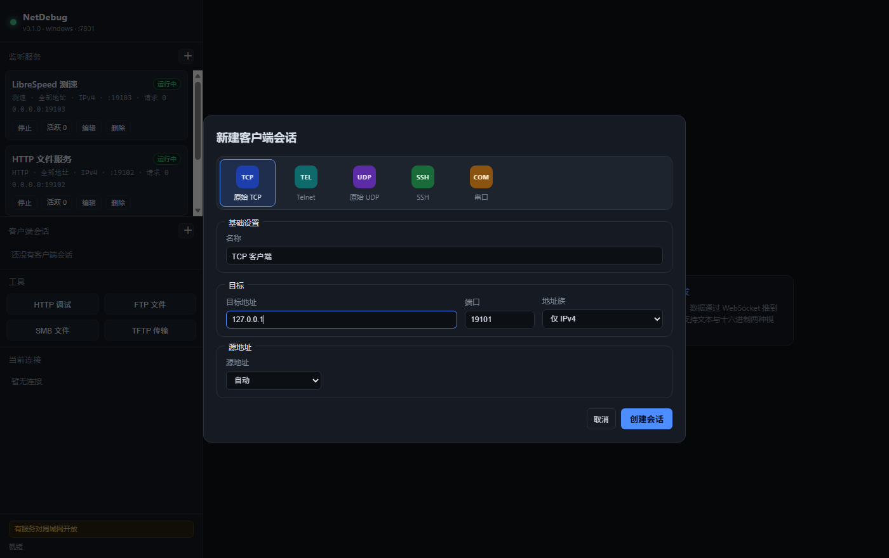

四种传输方式，表单会跟着变：

| 传输 | 用途 | 额外字段 |
|---|---|---|
| TCP | 连设备 TCP 端口 | 目标地址、端口、地址族、源地址 |
| UDP | 连设备 UDP 端口 | 同上 |
| SSH | 登录设备命令行 | 用户名、密码或私钥、兼容老算法开关 |
| 串口 | 本机串口设备 | 串口、波特率、数据位、校验、停止位、流控、DTR/RTS |

协议列在 TCP 下可选「原始」或「Telnet」；选 Telnet 时不能再选 UDP 传输。

**地址族**只在目标是域名时才有意义：`自动（按目标地址）`会试域名解析出来的所有地址，选「仅 IPv4 / 仅 IPv6」则只试对应一族。
如果目标填的是具体 IP（`192.168.1.10`、`fe80::1`、`[::1]`），地址族由地址本身决定，这一项会自动锁定并显示提示，不需要你再选。
后端也做了同样处理：即使传了不匹配的地址族，字面地址仍然按自身协议族解析。

**源地址**用来指定从哪块网卡、哪个 IP 发起连接，多网卡机器上可以把流量固定到某条链路。

会话卡片上的按钮随状态变化：

| 状态 | 按钮 |
|---|---|
| 未连接 | `连接` · `删除` |
| 已连接、终端未打开 | `打开终端` · `断开` · `删除` |
| 已连接、终端已打开 | `切到终端` · `断开` · `删除` |

- **断开**：关闭这条连接，会话保留，可以再点「连接」重连。**终端标签不会被关掉**，此前的输出保留，状态变成 `closed`。
- **删除**：连同连接一起删除，终端标签一并关闭，不会留下空的页签。

### 6.1 SSH

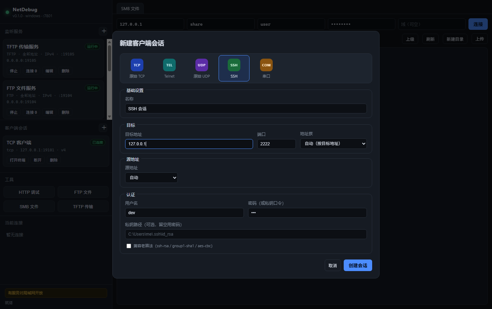

密码与私钥二选一：填了私钥路径就走公钥认证，私钥有口令时填在「密码」里。老设备只支持 `ssh-rsa`/`group1-sha1`/`aes-cbc` 时勾上「兼容老算法」。

### 6.2 串口

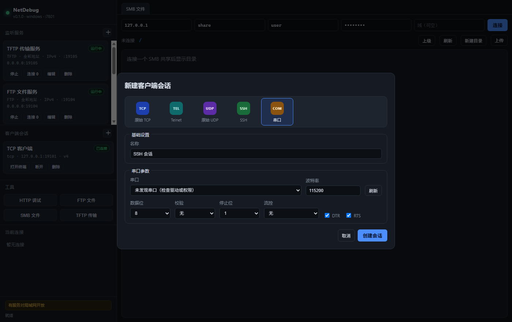

点「刷新串口」重新枚举。参数（波特率、数据位、校验、停止位、流控）按设备手册填。

---

## 7. 终端：收发数据

连接建立后工作区变成终端，默认是**终端仿真模式**（xterm）：

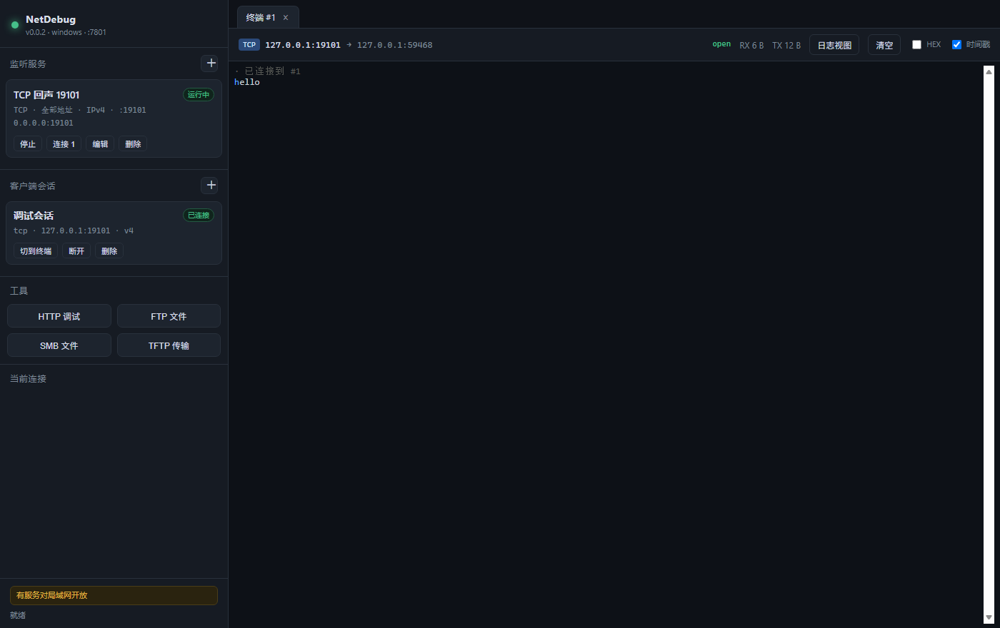

- 顶部：协议、对端地址 → 本地地址、状态（`open`/`closed`）、累计 RX/TX 字节，以及 `日志视图` 切换按钮。
- 终端区：完整的终端仿真，支持 ANSI 颜色、清屏、光标、选中复制、滚轮回看；**键盘直接输入**，回车即发送，不需要点发送按钮。
- 右上角 `清空` 清掉当前终端内容。

点右上角 `日志视图` 可以切到逐行日志模式：

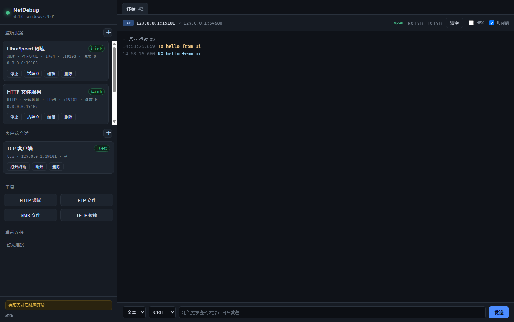

- 每一行标注时间戳和方向（`TX`/`RX`），适合核对时序。
- `HEX` 开关把收发按字节显示，用于二进制协议；发送时把编码切到 `HEX`，输入 `01 03 00 00 00 02` 这样的字节串。
- `行尾` 默认 CRLF，调 Telnet/AT 命令时按设备要求切换。
- 再点一次按钮切回终端视图。

要点：

- **串口、SSH、原始 TCP 用的是同一套终端**。串口设备的 ANSI 输出（比如带颜色的 shell）在终端模式下能正常显示，日志模式下会看到 `^[[32m` 这样的原始转义序列。
- 终端只渲染**收到**的数据，不做本地回显——回显由对端负责（串口设备通常自己回显）。
- 断开连接**不会关闭终端标签**，此前的输出会保留，标签状态变成 `closed`；只有删除会话才会连带关闭标签。
- 从「当前连接」也能打开别人的连接：设备主动连进来后，服务卡片下方的连接数会变化，点该连接即可实时看数据。

### 7.1 快捷发送与预置命令

终端底部有一条快捷发送栏（只在终端视图显示）：

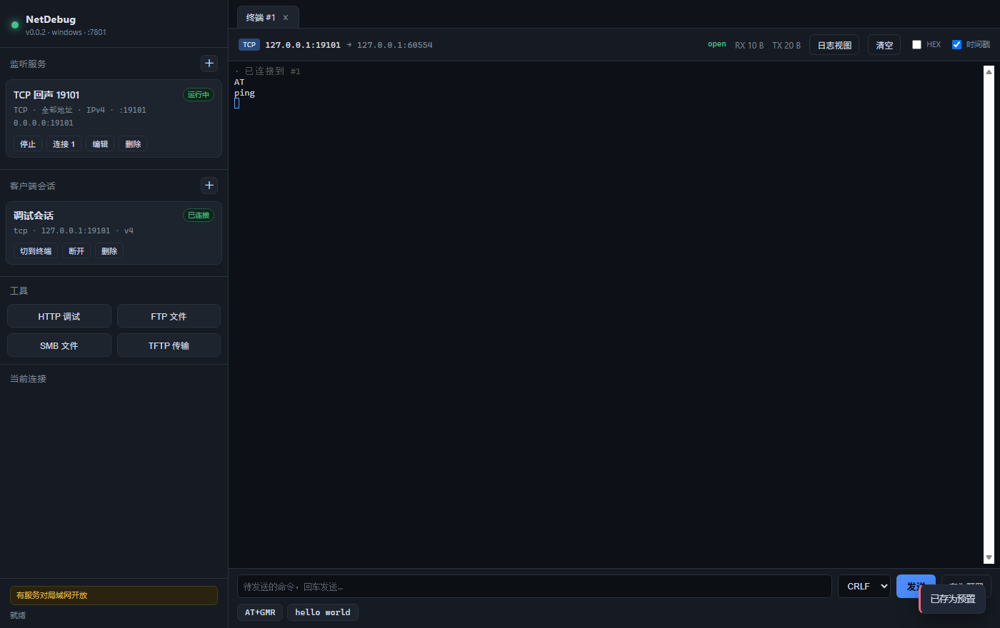

- **输入框**：写要发的命令，回车或点「发送」就按选定的行尾发出去；行尾可选 CRLF / LF / CR / 无。
- **存为预置**：把输入框内容存成一个按钮，之后点一下就能发送。
- **预置按钮**：左键发送，右键删除（会弹确认）。
- **预置是全局的**，所有会话（串口 / SSH / Telnet / TCP）共用同一组，最多 24 条；存在配置目录的 `presets.json` 里，重启程序后还在。

典型用法：串口设备存 `AT`、`AT+GMR`，Linux 主机存 `df -h`、`systemctl status nginx`，按设备切换时不用重敲。

---

## 8. 工具

### 8.1 HTTP 调试

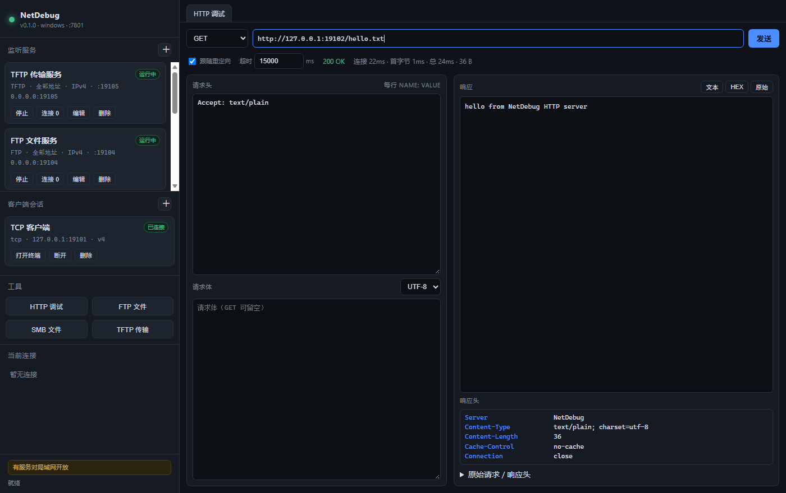

- 方法支持 GET/POST/PUT/PATCH/DELETE/HEAD/OPTIONS；可开关跟随重定向、设置超时。
- 请求头一行一个 `Name: value`；请求体可选 UTF-8 或 HEX。
- 状态行右侧给出发包耗时：`连接 20ms · 首字节 1ms · 总 22ms · 36 B`。
- 响应支持文本 / HEX / 原始三种视图，下方列出响应头。

展开「原始请求 / 响应头」能看到实际发出去的报文：

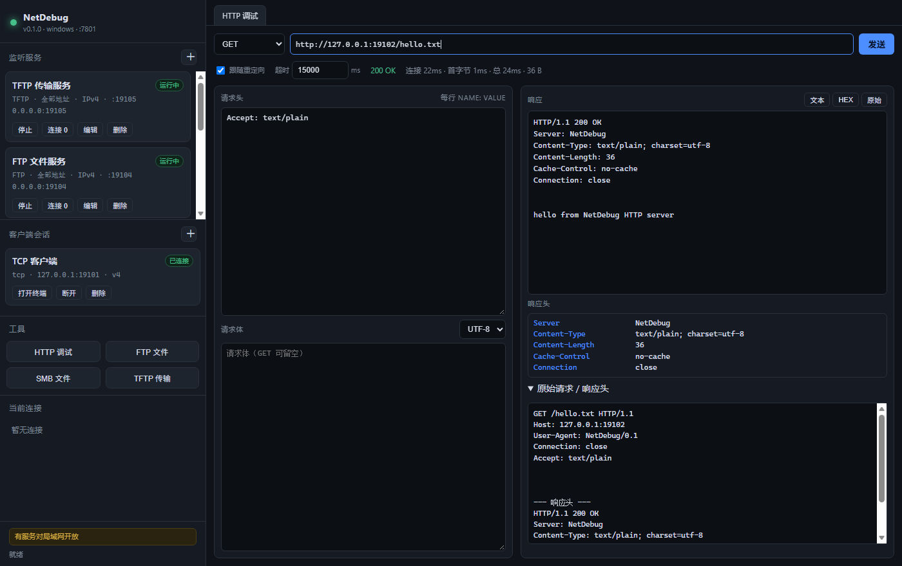

### 8.2 FTP 文件


填地址、端口、用户名密码后「连接」，列表显示名称/大小/修改时间，可下载、删除、新建目录、上传，`上级`/`刷新` 用来导航。

### 8.3 TFTP 传输


上半部分按「远端文件名」下载到本机 `downloads\`；下半部分「选择文件」后上传，上传上限 3MB。

### 8.4 SMB 文件

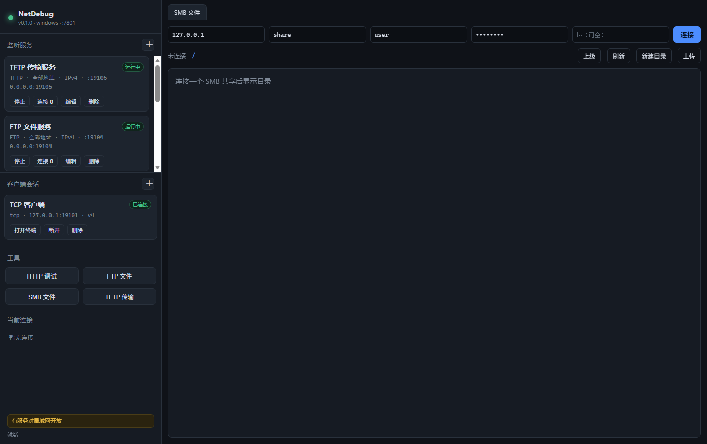

填服务器地址、共享名、用户名、密码、可选域，连上后与 FTP 一样浏览共享目录。支持 SMB2/3 + NTLMv2，需要目标机开启共享。

---

## 9. 窄窗口布局

把窗口拖窄到 760px 以下会自动切成单列：左上角出现菜单按钮，点开是抽屉式侧栏，对话框改为适配窄屏的高度。

| 窄窗口 | 抽屉展开 | 新建服务 |
|---|---|---|
| 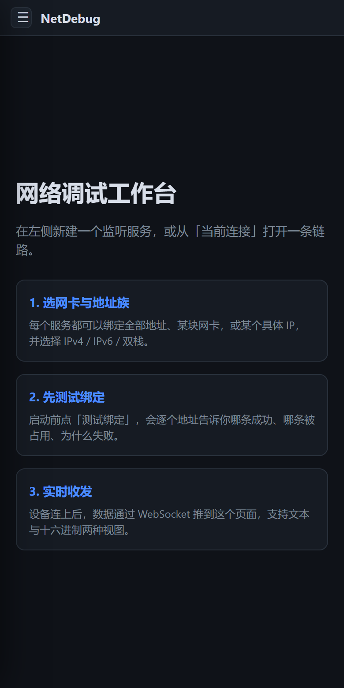 | 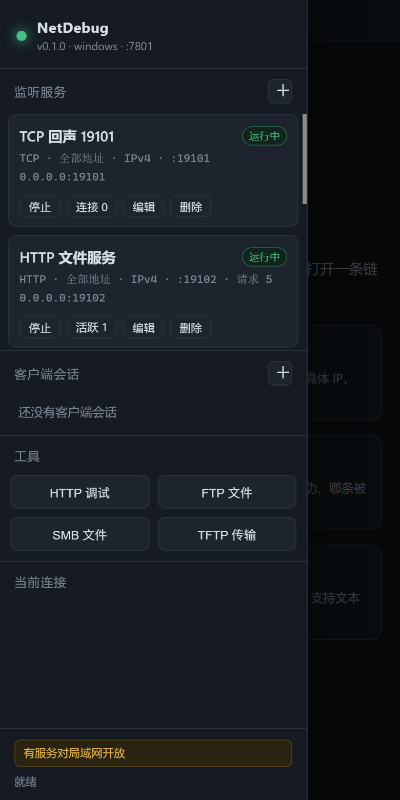 | 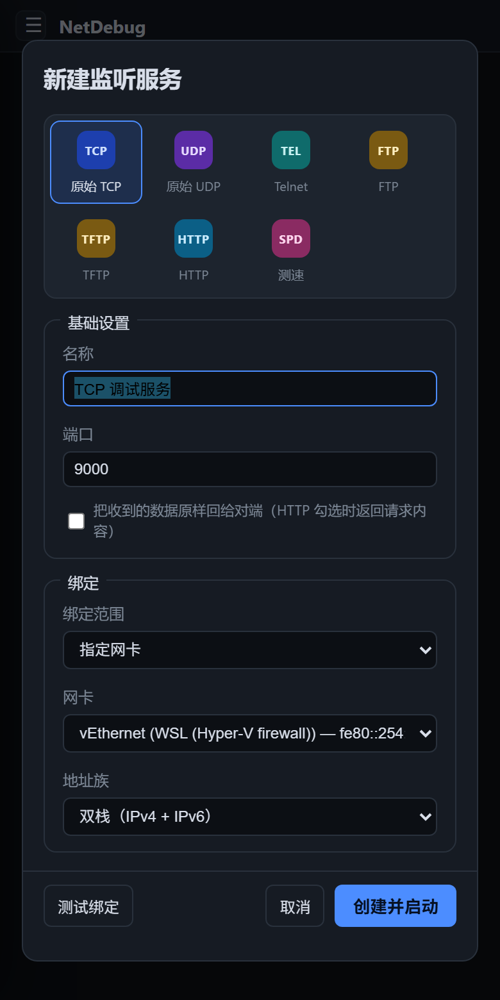 |

管理界面只在程序窗口里，手机/平板访问不到。

---

## 10. 常见问题

**端口被占用**
「测试绑定」或创建失败时会显示冲突地址与系统原因。换端口，或者先停掉占用方。Windows 上常见占用者是上次未退出的调试工具、IIS、其他设备模拟器。

**双栈建不起来**
绑定方式选「指定 IP」时不能选双栈——一个具体 IP 只有一个地址族。要么改成「全部地址」，要么选对应的地址族。

**选「指定网卡」后一条都绑不上**
该网卡没有对应地址族的地址。选「双栈」时只有一族地址会降级为可用（卡片上会有提示），选「仅 IPv6」则会直接失败。

**服务显示运行中但设备连不上**
1. 看卡片上的监听地址是不是设备能到的那个网卡/IP；
2. Windows 防火墙对入站端口的拦截（首次监听可能弹过询问）；
3. 服务绑在 `127.0.0.1` 或某块内网网卡上时，别的网段访问不到。

**重启后服务没起来**
只有退出时处于「运行中」的服务才会自动恢复。被打断（强制结束进程）的情况下可能来不及保存，手动点「启动」即可。

**浏览器打开提示「请使用 NetDebug 主窗口」**
这是预期的：管理界面只在程序窗口里提供，不通过浏览器访问。需要看界面就双击程序（或执行 `./netdebug`）打开窗口。

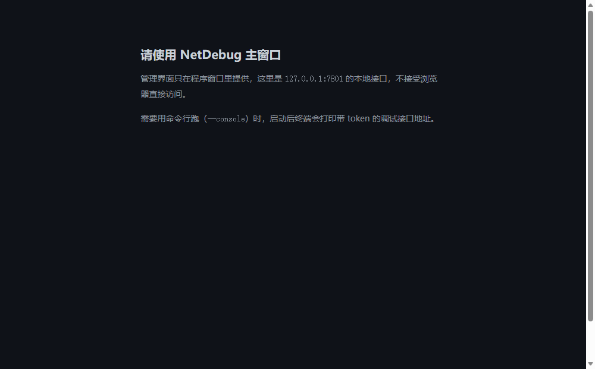

**日志在哪**
数据目录下的 `logs/netdebug.log`（Windows 默认 `%APPDATA%\NetDebug\`，Linux 默认 `~/.config/netdebug/`），
启动时程序也会打印实际路径。

---

## 11. 能力边界

- 管理页只监听 `127.0.0.1`/`::1`；监听服务可以按需对局域网开放，开放时左侧栏会提示。
- HTTP 服务端只有静态文件与目录列表，没有上传、没有 HTTPS。
- SSH 仅 Windows 构建启用（libssh2 + WinCNG）；未做 SFTP 与 known_hosts 校验。
- SMB 只有客户端，未做共享枚举、Kerberos、SMB1。
- 串口已实现枚举与参数配置，真实收发尚未用硬件验证。
- 文件上传经页面走 base64，单文件上限 3MB；更大的文件建议用 FTP。
- LibreSpeed 只启用四项基础指标。

---

相关文档：[README](../README.md) · [界面测试报告](ui-test-report.md) · [单元测试报告](test-report.md)
